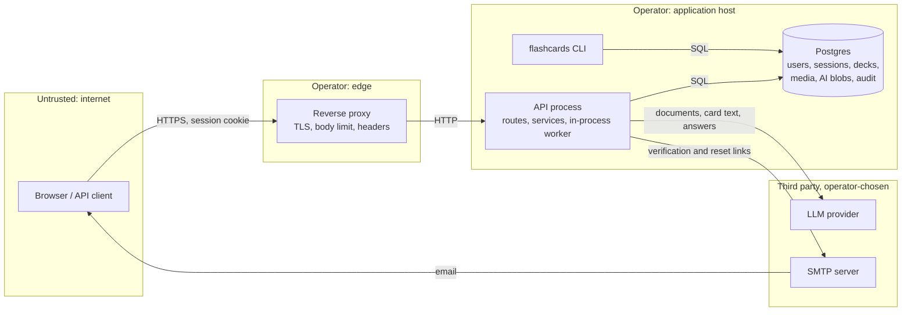

# Threat model

- **Status:** Living document (PRD NF-SEC-1)
- **Last reviewed:** 2026-11-08, against `main` at the card-browser and job-progress releases (ADR 0011, ADR 0012); updated for the security hardening in ADR 0017
- **Scope:** the API in `apps/api` and its deployment configurations (`render.yaml`, `deploy/compose/`). The web app (`apps/web`) is in development and is covered here only where the API's design depends on how it renders data.

This document describes the system as built. Every mitigation listed links to the code that implements it. Gaps are listed as residual risks, with recommended follow-ups at the end. Update it when a change adds an endpoint, a data store, an external dependency or a new kind of upload.

Paths below are relative to `apps/api/src/flashcards/` unless they start with a top-level directory.

## 1. System overview

Flash-Cards is an invite-only, spaced-repetition service with AI-assisted card generation. One FastAPI process ([`api/app.py`](../../apps/api/src/flashcards/api/app.py)) serves the HTTP API and runs the AI generation worker in-process ([`adapters/job_queue.py`](../../apps/api/src/flashcards/adapters/job_queue.py), ADR 0004). Persistence is Postgres through SQLAlchemy ([`adapters/sql.py`](../../apps/api/src/flashcards/adapters/sql.py)); uploaded media and AI source documents are stored as database rows (`media_assets`, `ai_blobs`). Without `FLASHCARDS_DATABASE_URL` the API runs in an in-memory mode intended for development only.

External dependencies:

- an LLM provider: Anthropic ([`adapters/anthropic_llm.py`](../../apps/api/src/flashcards/adapters/anthropic_llm.py)) or any OpenAI-compatible endpoint ([`adapters/openai_llm.py`](../../apps/api/src/flashcards/adapters/openai_llm.py)), chosen by the operator (ADR 0006);
- an SMTP server for verification and password-reset email ([`adapters/mailers.py`](../../apps/api/src/flashcards/adapters/mailers.py));
- a TLS-terminating reverse proxy in front of the API (Render's edge, or the Caddy service in `deploy/compose/`).

The API makes no other outbound requests. YouTube transcript retrieval is a port whose only adapter refuses ([`adapters/transcripts.py`](../../apps/api/src/flashcards/adapters/transcripts.py)), so user-supplied URLs are parsed but never fetched.

## 2. Assets

| Asset | Where | Why it matters |
|---|---|---|
| Account credentials | `users.password_hash` (Argon2id) | Account takeover |
| Session tokens | Cookie `fc_session`; only the SHA-256 hash in `sessions` | Session hijack |
| Invite, share, verification and reset tokens | Shown once or emailed; only SHA-256 hashes stored | Unauthorized sign-up, deck access, account takeover |
| Admin role | `users.role` | Controls who can join and every account's status |
| Study content | Decks, notes, cards, schedules, review logs | User data; shared decks reach other users |
| Uploaded documents and media | `ai_blobs`, `media_assets` | May contain personal or confidential material |
| Email addresses | `users.email` | Personal data |
| Audit log | `audit_events` | Accountability for admin and security events |
| AI provider budget | Provider API key and per-user quotas | Direct cost to the operator |
| Operator secrets | Environment (`.env`, Render dashboard) | Database, AI and SMTP access |
| Availability | Single API process, shared DB pool | Small instances are easy to exhaust |

## 3. Actors

| Actor | Capabilities | Trust |
|---|---|---|
| Anonymous internet user | Can reach `/healthz`, `/auth/signup`, `/auth/login`, `/auth/password-reset`, `/auth/password-reset/confirm`, `/auth/verify-email` | Untrusted |
| Invited member | Signed in; owns decks, uploads files, runs AI features, creates and follows share links | Trusted with their own data only |
| Admin | Member plus `/admin/*`: invites, user suspend, role, delete, unlock, audit log | Trusted to manage accounts; cannot read other users' content through the API |
| Operator | Shell, environment and database access; runs the CLI | Fully trusted; can read and change everything |
| Malicious uploader | A member submitting hostile `.apkg`, PDF, image, media or transcript files, or hostile content in a shared deck | Untrusted content from an authenticated source |
| Compromised or malicious LLM provider | Receives every document and text sent for AI processing; returns arbitrary responses | Untrusted output; trusted with confidentiality only by operator choice |
| Network attacker | Observes or modifies traffic between components | Untrusted |

## 4. Trust boundaries

1. **Browser to reverse proxy.** All user input crosses here. TLS is the proxy's job; the API never serves TLS itself.
2. **Proxy to API.** Plain HTTP on a private network or loopback (`127.0.0.1:8000` in `deploy/compose/compose.yaml`). The API trusts `X-Forwarded-*` from this hop.
3. **API to Postgres.** Credentials from the environment; Postgres is not published on the host in the compose stack.
4. **API to LLM provider.** User content leaves the operator's control here, and untrusted model output comes back.
5. **API to SMTP server.** Account links leave here.
6. **Uploaded bytes to parsers.** `.apkg` (zip and SQLite), PDF (MuPDF via PyMuPDF), images and audio (byte sniffing), transcript envelopes (JSON). Parsers run inside the API process.
7. **One member's content to another member.** Share-link preview and clone deliver one user's note text to another.
8. **Member to admin.** The `require_admin` dependency ([`api/deps.py`](../../apps/api/src/flashcards/api/deps.py)).

## 5. Threats and mitigations by component

Each table follows STRIDE: **S**poofing, **T**ampering, **R**epudiation, **I**nformation disclosure, **D**enial of service, **E**levation of privilege. "Residual" lists what the current code does not address.

### 5.1 Authentication and sessions

Code: [`api/routers/auth.py`](../../apps/api/src/flashcards/api/routers/auth.py), [`api/deps.py`](../../apps/api/src/flashcards/api/deps.py), [`application/auth_service.py`](../../apps/api/src/flashcards/application/auth_service.py), [`application/sign_in_service.py`](../../apps/api/src/flashcards/application/sign_in_service.py), [`domain/login_throttle.py`](../../apps/api/src/flashcards/domain/login_throttle.py), [`adapters/passwords.py`](../../apps/api/src/flashcards/adapters/passwords.py). Design: ADR 0010.

| | Threat | Mitigation | Residual |
|---|---|---|---|
| S | Password guessing against one account | Per-email lockout: at most 5 attempts per 15 minutes, counted before the password is checked so parallel attempts count too, then a 15-minute lock (`domain/login_throttle.py`). The failure that starts a lock is audited. A failed login is returned rather than raised so the count survives the request's rollback (`routers/auth.py`). | A per-address token bucket limits POST `/auth/*` to 20 requests a minute (`api/rate_limit.py`, ADR 0019), so spraying many accounts from one address is slow. The limit is per API process and an attacker with many addresses gets past it; a proxy limit covers the first (runbook). |
| S | Account enumeration | One message for unknown email and wrong password; a dummy Argon2 verify for unknown emails equalizes timing (`auth_service.py`). Unknown emails are throttled like real ones. Signup returns one generic error for every invite failure. Password reset always answers 202 and sends mail after the response. | Signup reveals whether an email is registered to anyone: `RegistrationService.register` checks the email (409) before it looks at the invite (400), so any token, valid or not, works as an oracle, and invite signup is limited only by the per-address limit on `/auth/*` (`application/registration_service.py`, ADR 0019). Reset requests for real accounts do slightly more work (ADR 0010). |
| S | Stolen password, phishing of codes, replayed second factor | Optional two-factor sign-in (ADR 0018): an authenticator app (TOTP), passkeys or single-use recovery codes. The password only creates a pending sign-in (random token, hash stored, 5 minutes, used once, sent in the body so it cannot be planted by a sibling subdomain); the session is issued after the second factor. Codes count against the same per-email lockout, and a right password does not clear the count. TOTP codes work once (last accepted step stored, conditional update); secrets are encrypted at rest (Fernet, `FLASHCARDS_TOTP_ENCRYPTION_KEYS`). Recovery codes have 80 random bits, are stored hashed and work once. Passkeys are bound to the public origin and RP id, and a counter that does not increase is refused and audited. Adding or removing a factor needs the password or a current code. | Optional: accounts without it, admins included, have one factor. TOTP codes can still be phished in real time; passkeys cannot. An admin can reset any user's second factor. Losing the encryption key disables every authenticator app. |
| S | Weak passwords | Minimum 12 characters (`domain/users.py`). Argon2id with argon2-cffi defaults. | No breach-list check. |
| S, I | Session theft | Opaque 256-bit random token; only its SHA-256 hash is stored, so a database leak does not yield usable sessions. Cookie is `HttpOnly`, `Secure` (default `FLASHCARDS_SESSION_COOKIE_SECURE=true`), `SameSite=Lax`, `Path=/` (`deps.py`). Sessions expire after 14 days and are checked on every request. Users can list and revoke their sessions; logout revokes server-side. | Absolute 14-day lifetime with no idle timeout and no rotation. Session list shows no device or IP information. |
| T | Cross-site request forgery | `SameSite=Lax` keeps the cookie off cross-site POST, PATCH and DELETE requests. Every unsafe request must also show a trusted origin (`api/csrf.py`, ADR 0017): a matching `Origin` (the public URL or the request's own host), `Sec-Fetch-Site: same-origin`, a matching `Referer`, or, with none of those headers, `X-Requested-With`, which a cross-origin page cannot send without a CORS preflight. This also refuses a hostile sibling subdomain. The API sends no CORS headers, so cross-origin scripts cannot read responses. | No per-session CSRF token; the check relies on browsers sending `Origin` or `Sec-Fetch-Site`, which every current browser does. |
| E | Suspended or deleted user keeps access | `current_user` rejects suspended users on every request; suspension and password reset revoke all sessions (`admin_service.py`, `account_email_service.py`). | None known. |
| I | Credentials in error responses | The validation-error handler strips submitted values from 422 responses (`api/app.py`). | None known. |
| D | CPU exhaustion through Argon2 | The lockout stops password checks for a locked email. Argon2 runs in worker threads, at most 4 at a time (`adapters/offload.py`, ADR 0017), so a burst of sign-ins queues for a slot instead of stalling the event loop, and its memory is bounded (64 MiB per operation). | Each new email address costs one Argon2 verify, and login and signup passwords have no length cap at the schema level. A burst still delays other sign-ins, though the per-address limit (ADR 0019) refuses a single client's burst before any hashing. |
| I | API schema discovery | `/docs` and `/openapi.json` exist only when `FLASHCARDS_ENVIRONMENT=development` (`api/app.py`). The Docker image defaults to production. | The repository is public, so the schema is public anyway; this only reduces noise. |

### 5.2 Invites and the first admin

Code: [`application/invite_service.py`](../../apps/api/src/flashcards/application/invite_service.py), [`domain/invites.py`](../../apps/api/src/flashcards/domain/invites.py), [`application/registration_service.py`](../../apps/api/src/flashcards/application/registration_service.py), [`cli.py`](../../apps/api/src/flashcards/cli.py).

| | Threat | Mitigation | Residual |
|---|---|---|---|
| S | Guessing an invite token | 256-bit `secrets.token_urlsafe` tokens; only the SHA-256 hash is stored. | None practical. |
| S | Reusing or racing an invite | Redemption is an atomic conditional update (`try_redeem`); expiry (default 7 days, at most 90), revocation and optional email binding are checked first. In SQL mode redemption and user creation share one transaction. | An unbound invite works for whoever holds it; tokens travel by whatever channel the admin uses. |
| E | Self-registration as admin | The role comes from the invite, never the request. Only admins (or the operator through the CLI) create invites. There is no public sign-up path. `FLASHCARDS_INVITE_ONLY` is not read by the code: invites are always required. | An admin can mint admin invites; see 5.7. |
| E | Startup bootstrap invite left on in production | `FLASHCARDS_DEV_BOOTSTRAP_INVITE` works only in in-memory mode (no database) and is ignored when `FLASHCARDS_ENVIRONMENT` is exactly `production` (`api/app.py`). | Any other environment name (for example `staging`) still seeds the invite in in-memory mode and logs its token. |
| I | First admin token exposure | The CLI needs shell and database access; the token is printed once. | The token sits in terminal scrollback or CI logs until redeemed. The runbook says to treat it as a secret. |

### 5.3 Email verification and password reset

Code: [`application/account_email_service.py`](../../apps/api/src/flashcards/application/account_email_service.py), [`domain/user_tokens.py`](../../apps/api/src/flashcards/domain/user_tokens.py), [`adapters/mailers.py`](../../apps/api/src/flashcards/adapters/mailers.py).

| | Threat | Mitigation | Residual |
|---|---|---|---|
| S | Reset-token theft or guessing | 256-bit tokens, stored as hashes, single-use (atomic `try_use`), purpose-bound, 1-hour expiry for reset and 48 hours for verification. Issuing a new token invalidates earlier ones. The token travels in the URL fragment, so it never reaches server or proxy access logs or `Referer` headers. A completed reset revokes every session, clears the lockout and is audited. | Anyone who can read the user's mailbox can reset the password; that is inherent to email reset. |
| T | Header injection through email addresses | Addresses are validated as plain dot-atom ASCII, refusing commas, spaces, quotes, angle brackets and control characters (`domain/users.py`); messages are built with `email.message.EmailMessage`. | None known. |
| I | Mail credentials or links in transit | SMTP always verifies certificates and host names; `none` security refuses credentials at startup (`mailers.py`). | `none` sends mail in clear to a local relay, by design. |
| I | Reset links in logs | Without SMTP, only the subject is logged outside development (`LogMailer`). | In `development` the full link is logged; never run a reachable instance in that mode. |
| D | Inbox flooding | One email per kind per account per minute; nothing is sent for unknown or suspended accounts. | No global send limit; spraying many registered addresses sends one mail each per minute. |
| E | Unverified accounts acting | Not mitigated: verification is recorded but no feature requires it. Accounts exist only through invites, which limits the impact. | See follow-ups. |

### 5.4 Uploads: `.apkg` import, AI source documents and media

Code: [`adapters/apkg.py`](../../apps/api/src/flashcards/adapters/apkg.py), [`api/routers/imports.py`](../../apps/api/src/flashcards/api/routers/imports.py), [`adapters/extraction.py`](../../apps/api/src/flashcards/adapters/extraction.py), [`application/generation_request_service.py`](../../apps/api/src/flashcards/application/generation_request_service.py), [`api/routers/ai.py`](../../apps/api/src/flashcards/api/routers/ai.py), [`api/routers/media.py`](../../apps/api/src/flashcards/api/routers/media.py), [`adapters/media.py`](../../apps/api/src/flashcards/adapters/media.py), [`domain/transcripts.py`](../../apps/api/src/flashcards/domain/transcripts.py).

| | Threat | Mitigation | Residual |
|---|---|---|---|
| T, E | Zip path traversal in `.apkg` | Entries with absolute paths or `..` are refused; nothing from the archive is written to disk except the collection database, to a fresh temporary file that is always deleted. Media files in the package are ignored. | None known. |
| D | Zip bombs and hostile SQLite | At most 10,000 entries, 500 MB declared total, compression ratio at most 100, and the collection's actual decompressed size capped at 200 MB. SQLite is opened read-only and immutable, only fixed queries run, and row counts are capped (100,000 notes, 200,000 cards). | The zip central directory is parsed before the entry guard (bounded by the 40 MB upload cap). Decompression (up to 200 MB) and SQLite parsing run in a worker thread, at most 2 parses at a time (`adapters/offload.py`, ADR 0017), so an import no longer stalls the event loop, but it still uses CPU inside the API process. |
| D | Oversized uploads | Size caps: 40 MB `.apkg`, 25 MB AI source, 25 MB media, 120,000-character transcripts. Every upload route reads in 1 MB chunks and answers 413 once over the cap, or at once when the parser already knows the size (`api/uploads.py`, ADR 0017), so the cap bounds memory. Every request body, JSON included, is capped at 50 MB before it is parsed, which also bounds the temporary files the multipart parser spools to before authentication (`api/body_limit.py`). | JSON field maps have no per-field size cap at the schema level (for example, note `fields`), only the 50 MB body cap. |
| T, E | Type confusion and active content | Types are sniffed from the bytes, never taken from the client: PDF, PNG and JPEG for AI sources; an image and audio allow-list for media, which excludes SVG and HTML. Media is served with `X-Content-Type-Options: nosniff`, only to its owner. | None known for media. |
| D, E | Hostile PDF | All PyMuPDF work (opening, page counting, extraction, rasterization) runs in a worker thread, one operation at a time (PyMuPDF does not support concurrent threads); a page is rasterized at a resolution that keeps it under 16 million pixels, checked from the page size before rendering; parse errors answer 422 (`adapters/extraction.py`, ADR 0017). At most `FLASHCARDS_MAX_UPLOAD_PAGES` (default 20) pages per document; page quota reserved before work starts. | MuPDF is a C library parsing untrusted input inside the API process, not in a sandbox (PRD NF-SEC-2 asks for sandboxed parsing), so a parser bug or a pathological file still costs the process CPU or memory. No antivirus hook. |
| D | Storage exhaustion | AI sources are bounded by the monthly page quota (10 pages by default). | Media uploads, imports and notes have no per-user count or storage quota. All of it is stored in Postgres. |
| I | Cross-tenant access to uploads | Every read is owner-scoped and answers 404 for another user's object (`media_service.py`, `generation_request_service.py`). | None known. |

### 5.5 AI generation and prompt injection

Code: [`application/ai_prompts.py`](../../apps/api/src/flashcards/application/ai_prompts.py), [`application/card_generation_service.py`](../../apps/api/src/flashcards/application/card_generation_service.py), [`domain/ai.py`](../../apps/api/src/flashcards/domain/ai.py), the two LLM adapters, [`application/ai_budget.py`](../../apps/api/src/flashcards/application/ai_budget.py), [`domain/quotas.py`](../../apps/api/src/flashcards/domain/quotas.py). Design: ADR 0006, PRD NF-SEC-6.

| | Threat | Mitigation | Residual |
|---|---|---|---|
| T, E | Prompt injection in uploaded documents, card text, answers or chat questions | Instructions are application-authored and sent as the system prompt; user material is sent only as separate document, image or user content blocks, never concatenated into instructions, and each prompt tells the model to treat it as data. No tools are declared, so the model cannot act. Output is constrained to a JSON schema and re-validated by the domain (`parse_draft_cards` refuses non-string fields, unknown types and over-long lists). Generated cards are drafts until the owner approves them (F-AI-4). | Injection can still steer what the model writes within the schema: wrong or misleading cards, summaries, chat answers, and grading scores. Summaries, chat answers and grades are shown without an approval step. A member who clones a hostile shared deck feeds its content into their own AI calls. |
| I | Disclosure to the LLM provider | The provider is the operator's choice; a local OpenAI-compatible endpoint keeps data on the operator's infrastructure (ADR 0006). The API sends only the document or text needed for the request. | With a hosted provider, every uploaded document, deck used for summaries or exams, typed answer and chat question leaves the instance. Users are not told which provider is in use. |
| T, E | Compromised or malicious provider output | Same schema validation as above. The OpenAI-compatible adapter refuses responses over 5 MB, keeps its error messages generic and logs the detail server-side; Anthropic output is bounded by `max_tokens`. Synchronous AI routes answer with a generic 502 or 503 (`api/app.py`). A failed generation job stores only a fixed category message, never exception text, and the worker logs the detail (`domain/jobs.py` `JobFailure`, ADR 0017). | A provider can return any schema-valid text, including HTML or script payloads in card fields (see 5.6 on rendering). A slow provider holds the single generation worker, delaying every queued job (head-of-line blocking). |
| D | Provider cost exhaustion | Monthly page quota for generation, reserved before work starts (default 10 pages per user). Daily cap of 200 synchronous AI calls per user, charged before each call. At most `FLASHCARDS_MAX_CONCURRENT_AI_CALLS` (default 4) synchronous calls at once, with a 30-second wait before answering 503 (`deps.ai_slot`). | Many members together can still spend up to their combined quotas, bounded by the instance's monthly spend cap. Each call holds an upper estimate of its cost against the cap before it starts and settles it with the actual cost (ADR 0019), so concurrent calls pass the cap by less than one call's estimate, plus any underestimate of image input. A hold left by a crashed process blocks its estimate for up to an hour. |
| D | Database pool exhaustion by slow AI calls | `ai_slot` is acquired before the request opens a database session, so waiting requests hold no connection. | None known. |
| I | SSRF through video links | URLs are parsed against a fixed YouTube host list and never fetched; no transcript fetcher is configured. The OpenAI base URL comes only from operator configuration. | A future transcript fetcher must keep the host allow-list and run without access to internal networks. |

### 5.6 Sharing links

Code: [`api/routers/sharing.py`](../../apps/api/src/flashcards/api/routers/sharing.py), [`application/sharing_service.py`](../../apps/api/src/flashcards/application/sharing_service.py), [`domain/sharing.py`](../../apps/api/src/flashcards/domain/sharing.py). Design: ADR 0009.

| | Threat | Mitigation | Residual |
|---|---|---|---|
| S | Guessing a share token | 256-bit tokens; only hashes stored; the raw token is returned once at creation. | None practical. |
| I | Access by outsiders | Preview and clone require a signed-in account, so links are useful only inside the instance. Links serve read-only content and never reveal the owner. Revocation takes effect on the next request; links of a suspended or deleted owner stop working. Link management is owner-scoped. | Links expire after 1, 7, 30 (default) or 90 days, or never, as the owner chooses; links made before ADR 0019 never expire unless the owner sets a lifetime. Preview and clone are limited to 60 requests a minute per address. The token is in the URL path, so it appears in API and proxy access logs and browser history; anyone who can read those logs can use the link. |
| D | Resource use through preview and clone | Preview samples at most 200 decks and 200 notes with fields trimmed to 500 characters. Clone counts decks, notes and cards against caps (500, 20,000, 20,000) before writing anything, reserves a daily clone allowance of 50,000 cards, and takes an `ai_slot` so clone bursts cannot take every connection. | None known beyond the general lack of per-user storage quotas. |
| T, E | Cross-user stored XSS through shared content | Clones copy content only, never review history. | Note fields are stored and returned verbatim. Imported Anki notes routinely contain HTML, and AI drafts can contain anything the provider returned. The API does not sanitize, so preview and clone deliver one user's markup to another. The web app must render fields as text, or sanitize with an allow-list, and ship a strict Content-Security-Policy. |

### 5.7 Admin console and audit log

Code: [`api/routers/admin.py`](../../apps/api/src/flashcards/api/routers/admin.py), [`application/admin_service.py`](../../apps/api/src/flashcards/application/admin_service.py), [`application/audit_service.py`](../../apps/api/src/flashcards/application/audit_service.py), [`domain/audit.py`](../../apps/api/src/flashcards/domain/audit.py). Design: ADR 0010.

| | Threat | Mitigation | Residual |
|---|---|---|---|
| E | Member reaching admin endpoints | Every `/admin/*` route depends on `require_admin`, which reads the role from the database on each request. | None known. |
| E | Admin lockout or takeover races | Admins cannot suspend, demote or delete themselves; changes lock the admin rows first, so at least one active admin always remains; an admin demoted mid-request cannot act (`AdminRequired`). There is no impersonation. An admin who loses the role loses their unredeemed invites. | A compromised admin account can mint further admin invites and suspend or delete every other user. No second factor or re-authentication for admin actions. |
| R | Denying an admin or security action | Append-only audit log of invite, user, lockout, password-reset and verification events, with actor and target ids and no personal data (`domain/audit.py`). Readable by admins only. | The log is append-only in the application, not in the database: the operator, or anyone with database write access, can alter it. No export or external sink. Not every failed sign-in is audited, only the one that starts a lock (by design, to avoid log flooding). |
| I | Admins reading user content | The admin API exposes accounts (email, role, status, timestamps) and the audit log, not decks, uploads or media. | The operator can read everything in the database. |
| D | Audit and token tables growing | Bounded page size (200) when reading. | No retention or purge yet for `audit_events`, `login_throttle` and `user_tokens` (ADR 0010). |

### 5.8 Server-Sent Events for job progress

Code: [`api/job_events.py`](../../apps/api/src/flashcards/api/job_events.py), `job_progress_events` in [`api/routers/ai.py`](../../apps/api/src/flashcards/api/routers/ai.py). Design: ADR 0012.

| | Threat | Mitigation | Residual |
|---|---|---|---|
| I | Watching another user's job | Ownership is checked before streaming and again on every poll; another user's job is 404. | An open stream does not re-check the session, so signing out, suspension or a password reset takes effect on that stream only when it ends (at most 10 minutes). It exposes only the caller's own job status. |
| D | Connection exhaustion | At most 4 open streams per user; each stream lasts at most 10 minutes; no database connection is held between polls; finished jobs answer 204 so `EventSource` stops reconnecting. | The per-user limit is counted per process (ADR 0012). Each stream costs one small query per second. |
| D | Buffering proxies breaking the stream | `X-Accel-Buffering: no` and `Cache-Control: no-cache`; Caddy is configured with `flush_interval -1`. | Other proxies need equivalent settings (runbook). |

### 5.9 Data export and account deletion

Code: [`api/routers/account.py`](../../apps/api/src/flashcards/api/routers/account.py), [`application/account_service.py`](../../apps/api/src/flashcards/application/account_service.py). PRD NF-PRIV-1.

| | Threat | Mitigation | Residual |
|---|---|---|---|
| I | Exporting someone else's data | Export is built only from the caller's own records; the password hash is not included. | None known. |
| S, T | Stolen session used to export or delete an account | Requires a valid session. Deletion is audited, and the last active admin cannot be deleted. | No password re-entry for export or deletion. A hijacked session can take a full export or erase the account. |
| I | Data surviving deletion | Deletion removes jobs, stored sources, drafts, goals, decks, notes, cards, schedules, review logs, media, mock exams, passages, quotas, share links, the sign-in throttle row, tokens, sessions and the user, in one transaction in SQL mode. Invites the user sent are revoked. Audit events keep only ids. The response sends `Clear-Site-Data: "cache"`, and the web client removes the account's queued offline answers, cached study data and remembered user from the device (ADR 0019). | Database backups keep deleted data until they expire (runbook). Browser storage is cleared by the web client, not by the header, so another client must clear its own. |
| D | Large exports | Owner-scoped; the response carries media metadata only, not the bytes. | Building the export loads every media blob into memory (`SqlMediaRepository.list_for_owner`) and runs one schedule query per card (`account_service.py`), so a large account makes an expensive request. |

### 5.10 Deployment and operations

Code and configuration: [`apps/api/Dockerfile`](../../apps/api/Dockerfile), [`apps/api/entrypoint.sh`](../../apps/api/entrypoint.sh), [`deploy/compose/`](../../deploy/compose/), [`render.yaml`](../../render.yaml), [`config.py`](../../apps/api/src/flashcards/config.py), [`.github/workflows/ci.yml`](../../.github/workflows/ci.yml).

| | Threat | Mitigation | Residual |
|---|---|---|---|
| I | Secrets in the repository or image | All secrets come from the environment; gitleaks runs in CI; `.env` is git-ignored and excluded from the Docker build context by `.dockerignore`; the image contains no configuration secrets. | Operators must protect `.env` and the hosting dashboard. |
| E | Container escape impact | The API runs as an unprivileged `appuser`. In the compose stack Postgres is not published, the API is published on loopback only, and the proxy has no network path to Postgres. | No read-only root filesystem or dropped capabilities yet. |
| I, T | Traffic interception | HTTPS at the proxy; `Secure` cookie; HSTS from the bundled Caddyfile. | TLS between API and Postgres is not configured in the compose stack (same host, private network). |
| T | Spoofed forwarding headers | The compose stack trusts `X-Forwarded-*` only because the API is unreachable except through loopback and the proxy network. The client address keys the per-address rate limit and the public sign-up throttle (ADR 0016, 0019); the bundled Caddy and the runbook's nginx example overwrite `X-Forwarded-For` with the connecting address. | Publishing the API port beyond loopback would let clients spoof these headers. A host proxy that appends to a client-supplied `X-Forwarded-For` (nginx `$proxy_add_x_forwarded_for`) lets clients choose their rate-limit bucket, because the compose stack trusts every hop (`FORWARDED_ALLOW_IPS=*`). |
| D | Single process | `restart: unless-stopped` restarts the API when its process exits; the healthcheck gates startup ordering (the proxy waits for a healthy API) but Compose does not restart a container for being unhealthy. A job that fails can be retried by its owner (ADR 0012). | One process serves requests and generation; CPU-heavy parsing (5.4) competes with request handling. The job queue lives in memory, but at startup jobs left queued are enqueued again and jobs left running are requeued as a new attempt that resumes from its completed pages; the attempt number stops a run still alive in an old process. A stopping worker hands its job back, and a sweep every minute picks up jobs left queued or idle for 45 minutes. Each interruption spends an attempt, so a job that crashes the process cannot loop forever (ADR 0017). |
| I | Missing browser security headers | The bundled Caddyfile sets HSTS, `nosniff`, `Referrer-Policy: no-referrer` and `X-Frame-Options: DENY`. | The API sets none itself, so other proxies must add them. No Content-Security-Policy yet (it depends on the web app). |

## 6. Residual risks, ranked

Ranked by likelihood and impact for an invite-only instance with tens of members.

1. **Stored XSS through note content (high, once the web app ships).** Note fields from `.apkg` imports and AI drafts are stored and returned verbatim, and share links deliver them to other members (5.6). Safety depends entirely on the web app rendering fields as text or sanitizing them, plus a strict CSP.
2. **Untrusted parsing in-process (medium, reduced).** MuPDF parses hostile PDFs in-process, unsandboxed (5.4). Parsing and Argon2 now run in bounded worker threads and rendered pages are pixel-capped (ADR 0017), so they no longer stall the event loop, but a parser bug still runs inside the API process.
3. **Unbounded memory on `.apkg` and AI uploads (closed, ADR 0017).** Every upload route enforces its cap while reading, and every request body is capped at 50 MB before parsing (5.4).
4. **CSRF (closed, ADR 0017).** Unsafe requests must show a trusted origin in addition to `SameSite=Lax` (5.1).
5. **Share tokens in URL paths (medium, reduced).** Working links end up in access logs and browser history; links now expire, by default after 30 days (ADR 0019, 5.6).
6. **Account enumeration, distributed guessing, optional second factor (medium, reduced).** Invite signup still reveals which emails are registered. Sign-in, sign-up, reset and share routes are limited per client address, in each API process (ADR 0019), so guessing and Argon2 load need many addresses; a proxy limit makes it global (5.1). Two-factor sign-in is optional, not required for admins (ADR 0018, 5.7).
7. **Prompt injection steering unreviewed AI output (low to medium).** Summaries, chat answers and grades have no approval step; shared decks are a delivery path (5.5).
8. **Internal error text in job errors; interrupted jobs (closed, ADR 0017).** Failed jobs store a fixed category message and the detail is logged (5.5); interrupted jobs are requeued at startup (5.10).
9. **No per-user storage quota (low to medium).** Media, imports and notes can grow without bound in Postgres (5.4).
10. **Sensitive actions without re-authentication (low).** Export and account deletion need only a session (5.9).
11. **Audit log mutable at the database level, tables never purged (low).** (5.7)

## 7. Recommended follow-ups

| # | Follow-up | Addresses |
|---|---|---|
| 1 | Web app: render note fields as text by default; where rich text is needed, sanitize with an allow-list (for example DOMPurify) at render time. Serve a strict CSP (`default-src 'self'`, no inline script, `object-src 'none'`, `frame-ancestors 'none'`). Add a test that imported HTML is inert. | Risk 1 |
| 2 | Move PDF and `.apkg` parsing into a sandboxed worker process with memory and CPU limits. (Done in ADR 0017: off the event loop in bounded threads, pixel cap before rasterizing, Argon2 in a thread.) | Risk 2 |
| 3 | Cap JSON field-map sizes. (Done in ADR 0017: chunked, capped reads for every upload route and a 50 MB cap on every request body.) | Risk 3 |
| 4 | Done in ADR 0017: `Origin`, `Sec-Fetch-Site`, `Referer` and `X-Requested-With` check for unsafe methods. | Risk 4 |
| 5 | Move share tokens out of the path (fragment on the web side, sent in a header or POST body to the API) or redact `/shared/*` paths from access logs. (Link expiry is done in ADR 0019.) | Risk 5 |
| 6 | Validate the invite before checking whether the email exists at signup; cap password length in `LoginRequest` and `SignupRequest`. (The per-address limit in the API and the proxy examples are done in ADR 0019; a shared limiter store would make the API's limit global across processes.) | Risk 6 |
| 7 | Label AI-produced summaries, answers and grades as generated in the UI; consider an approval or report step for chat answers on shared material. | Risk 7 |
| 8 | Done in ADR 0017: categorized failure messages, details logged. | Risk 8 |
| 9 | Per-user storage quotas for media and imports, configurable by admins together with the AI quotas (F-ADMIN-3). | Risk 9 |
| 10 | Require the current password for account deletion, export and session-wide changes. | Risk 10 |
| 11 | Purge expired throttle and token rows on a schedule; add audit retention and an optional external log sink; restrict the application database role from `UPDATE` and `DELETE` on `audit_events`. | Risk 11 |
| 12 | Decide what `FLASHCARDS_INVITE_ONLY` does. (`FLASHCARDS_MAX_UPLOAD_PAGES` is wired in ADR 0017.) | Configuration accuracy |
| 13 | Decide whether email verification gates anything (for example password reset eligibility or sharing). | 5.3 |
| 14 | Done in ADR 0017: recovery at startup, hand-back on shutdown and a periodic sweep. | Risk 8, 5.10 |
| 15 | Re-check the session periodically inside long-lived SSE streams. | 5.8 |
| 16 | Require two-factor sign-in for admins; offer passwordless passkey sign-in. (Optional TOTP, passkeys and recovery codes are done in ADR 0018.) | Risk 6, 5.7 |
